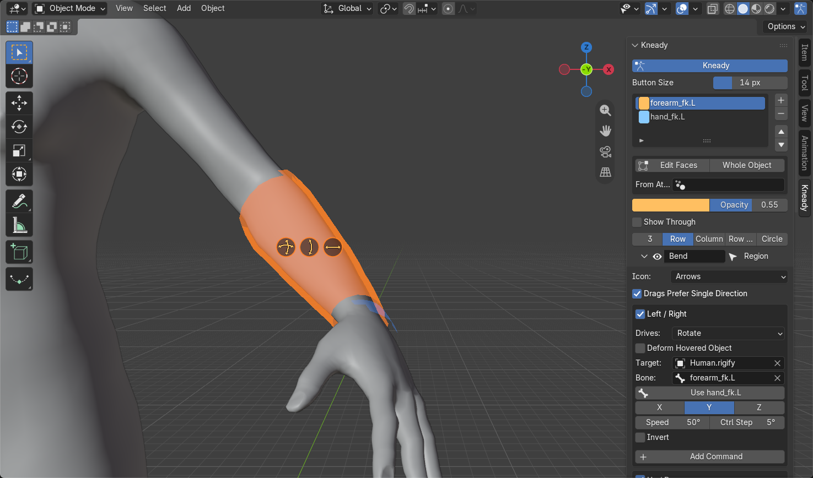

# Kneady Controls

**A deformation control system carried by the meshes it deforms.**

Kneady Controls (Kneady, for short) puts controls on the mesh itself. Mark some faces as a region (a
forearm, a cheek, an eyelid) and choose what dragging it drives: a bone, an
object, a Geometry Nodes input, or any property. Then hover the mesh and
drag. You don't have to hunt for the right bone in a crowded rig, or leave
the viewport to find a slider.

## What it does

- **Regions** are faces of a mesh, or a whole object. Hovering an object
  paints its regions, or outlines them, and the one under the mouse
  brightens.
- **Buttons:** a region's buttons show as circles in its middle when it is
  hovered, each named when the mouse is over it. Each runs its own set of
  commands. Dragging anywhere else on the region runs the first. A toggle
  button switches something on and off with a click, such as an IK / FK
  switch, and stays lit while it is on.
- **Beyond the row:** a button can sit at its own point on the item, show
  as a 3D handle (an arrow, a ring, or a shape you model) that you drag in
  the scene, open a menu of more buttons, or show only while a switch is on.
  A toggle can keep the pose as it switches IK and FK.
- **Commands:** each drag direction (up and down, left and right) can drive
  up to sixteen things at once:
  - turn, move or scale an object or a bone about its own axes, following
    the mouse
  - a Geometry Nodes modifier input
  - any property by its data path: an IK / FK switch, a shape key, a
    material value
- **It works the way Blender does.** Object mode and Pose mode both work,
  and so does Auto Keying with its settings. Hold Shift for fine control and
  Ctrl to snap. You can type a number during a drag, or change it afterward
  in the Adjust Last Operation panel. Each drag is one undo step.
- **It says why.** When something can't move, Kneady tells you what is
  holding it: a locked channel, a driver, a constraint, or an IK / FK switch.
- **It teaches.** Resting the mouse on a button shows what each drag and
  click does, and **Help** sets how much it tells you: Learn, Inform or
  Quiet. At Learn, where Kneady starts, **tutorials** play in a panel beside the view: short
  clips, a step's text, the fields it is about lit in the panel, each step
  ticked off as you do it, in a practice scene of its own. You can write
  your own in the same panel.
- **Regions travel with the mesh.** They stay with it through saving,
  appending and duplicating, and they work on a character linked into a
  shot through a library override. A region's buttons can be copied and
  pasted onto another region, in the same file or another.

## Requirements

Blender 4.2 or newer. Tested on Windows with Blender 4.2, 4.5, 5.2 and 5.3, on
Rigify, Auto-Rig Pro, Blender Studio's Rain, Mixamo and MPFB2 characters.

What Kneady asks of your computer, as Blender lists it when installing:

- **Clipboard:** copying and pasting buttons between regions and files.
- **Files:** keeping your Help level in Blender's config folder, and copying
  a tutorial's practice scene to open it.
- **Network:** downloading a tutorial's clips and images, and only while
  Blender's **Allow Online Access** is on (Preferences > System). Nothing
  else is sent or fetched.

## Install

- **From Blender:** Edit > Preferences > Get Extensions, search for Kneady,
  Install.
- **From a file:** download `kneady-<version>.zip` from this repository's
  Releases. In Blender, open Edit > Preferences > Get Extensions, open the
  ⌄ menu at the top right, choose Install from Disk, and pick the zip.

## Start in two minutes: a rigged character

1. Select the armature, switch to Pose mode, and click the bone you want to
   control, for example the forearm.
2. Switch back to Object mode and select the character's mesh. Open the
   sidebar (N) and the **Kneady** tab, then press **+**. The new region is
   named after the bone, and dragging it turns that bone.
3. Press **Edit Faces**, then **Select Faces of \<bone\>**, then **Assign**,
   then **Done**. Kneady finds the faces from the bone's vertex groups.
4. Turn Kneady on with the **Kneady** button at the top of the panel, or
   the icon in the viewport header.
5. Hover the forearm and drag. Up and down turns the bone about its X axis,
   left and right about its Y axis. To pose in Pose mode, select the
   armature and switch to Pose mode; hovering and dragging the mesh works
   the same way.

## Start with anything else

Select any mesh and press **+**. To use part of it, press **Edit Faces**,
select the faces, **Assign** and **Done**. To use all of it, press **Whole
Object**. Under the region's first button, choose what each direction
**Drives**. A new region turns the object itself until you change that.

## Learn more

The [guide](docs/GUIDE.md) covers everything:

- regions, buttons and commands
- dragging, typing values, posing and keying
- notes for common rigs, including their IK / FK switches
- placed buttons, 3D handles and menus
- tutorials, and [writing your own](docs/TUTORIALS.md)
- linked characters, modifiers, and what Kneady can't do yet

## Reporting a problem

Open an issue on this repository. Include your Blender version, your
operating system, the rig or character you were using, and the steps that
lead to the problem. A small .blend file that shows it helps most.

If something goes wrong without a message, look in Blender's console: on
Windows, Window > Toggle System Console; on Linux and macOS, the terminal
Blender was started from. Kneady prints each error it caught there once,
starting with "Kneady:". Paste that into the issue.

## License

GPL-3.0-or-later. See [LICENSE](LICENSE).

`qrcodegen.py`, which draws a tutorial's QR code, is Project Nayuki's QR
Code generator, under the MIT License written at its top.

The tutorials' clips and practice scenes (`tutorials/`) are dedicated to
the public domain under
[CC0 1.0](https://creativecommons.org/publicdomain/zero/1.0/): use them for
anything, no credit needed.
